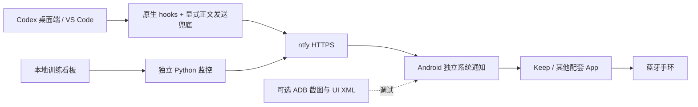

# TinyAgent Wrist

**Turn a cheap fitness band into an AI agent companion.**

**让普通低成本智能手环成为 AI Coding Agent 的随身交互终端。**

核心目标：无需 Wear OS，无需修改固件，让受限智能手环也能参与人机协作。

当前实现把 Codex 的**完成正文、问题与选项**送到 Android 手机，再通过配套 App 转发到手环；附带 USB Android 控制工具和独立训练告警适配器。首版支持消息接收与查看，回复和权限批准仍在手机或电脑完成，手环双向输入尚未实现。

**实测组合：Windows + Codex 桌面端 / VS Code + vivo Android + ntfy + Keep + Keep B4 Lite。** 其他手机、手环、配套 App 尚需验证。当前为 `0.1.0`，修复后熄屏测试已通过，长期稳定性仍需观察。



日常通知依靠互联网和手机与手环的连接，**无需 USB，手机也无需靠近电脑**。USB 只用于授权后的截图、点击和诊断。项目不包含手机 App、不直接实现手环蓝牙协议，也不需要 Root。

## 有什么不同

- Windows 友好：配置生成器自动生成本机绝对路径，同时保留已有 hooks，不改信任哈希。
- 内容通知：发送最终回复前420字，以及问题正文、选项；原始权限申请默认静音，输入框预测建议过滤。
- 双入口去重：原生 hooks 与显式发送兜底共用短时间内容去重，处理曾观察到的原生事件漏发。
- 分段诊断：区分服务器接收、手机 App 列表、系统通知、手环实际提醒；常驻服务通知不算成功。
- 训练接入：普通 Python 常驻进程每30秒检查看板，检测完成、GPU/CUDA已上报错误、Loss异常、停滞；不依赖 Codex 定时任务。

创新主要是上述组件的集成、可靠性处理和真机排障方法。Codex→ntfy、ADB 自动化和通知兜底均有已有项目，不能声称这些能力由本项目首创。参见[同类项目与定位](docs/comparison.md)。

## 快速开始：先打通手机通知

需要 Python 3.11+，Windows PowerShell，手机已安装 ntfy、Keep 并连接手环。仅通知不需要 ADB 或 Pillow；截图工具需要 Pillow。ADB、scrcpy 请自行从官方安装，仓库不重新分发它们。

```powershell
git clone https://github.com/xiao634zhang/TinyAgent-Wrist.git
cd tinyagent-wrist
py -3 -m venv .venv
.\.venv\Scripts\python.exe -m pip install -r requirements.txt
.\.venv\Scripts\python.exe configure.py
```

在本地打开生成的 `notification_config.json`，手机 ntfy 订阅同一 `server` 和 `topic`。主题由随机数生成，不在终端自动打印，切勿上传配置。

在 vivo 上，**ntfy → 应用信息 → 电量 / 后台耗电管理 → 允许后台耗电**；确认联网及 Android 通知权限。ntfy 开启实时推送（部分无 Firebase 版本始终使用实时推送，不显示开关）。Keep 允许读取通知，在手环消息设置里选择 ntfy 或“其他通知”，保持手环已连接。各厂商菜单名称不同。

回到手机桌面并熄屏，然后手动发送一条不含私人信息的测试。将 `YOUR_RANDOM_TOPIC` 换成本地配置中的主题：

```powershell
.\.venv\Scripts\python.exe send_notification.py --server https://ntfy.sh --topic YOUR_RANDOM_TOPIC --title "WRIST-TEST-1" --message "Manual test: check system notification and wristband"
```

服务器回执只说明服务器接收；请分别核对**手机系统通知栏和手环**。先看通知栏，再打开 ntfy。正在查看该主题时，ntfy 会抑制其系统通知；打开主题还可能清掉已显示的通知。

## 接入 Codex

先阅读[隐私说明](SECURITY.md)：启用后，正文会发往你选择的 ntfy 服务。默认公共服务器和随机主题不是端到端加密，也不是可靠访问控制；敏感用途请使用有访问控制的服务器/主题。

```powershell
# 显式同意发送回复/提问正文，并合并 hooks 和兜底规则
.\.venv\Scripts\python.exe configure.py --install-hooks --install-rules
```

安装器保留其他 hooks 和 AGENTS.md 文字，备份放在被 Git 忽略的 `logs/`。随后在 Codex 的 Hooks 界面（支持时使用 `/hooks`）审阅并信任新增条目，再重新加载/恢复会话。**安装并不等于已经信任或真实触发。** 同一 Windows 用户/CODEX_HOME 下可供桌面端与 VS Code 使用；WSL、SSH 或其他 CODEX_HOME 需另配。

检查生成的 `fallback-rules.generated.md`，其中规定提问前调用 `notify_question.py`，最终回复前调用 `notify_completion.py`；它是让代理显式执行的兜底，不是后台监听所有聊天。若运行环境没有载入规则，兜底不会自动发生。

完整步骤、撤销方法和测试区分见[复现教程](docs/tutorial.md)。

## 可选功能

- [Android 控制](docs/tutorial.md#android-控制)：截图、UI XML、点击、滑动、返回、启动 App；中文输入不直接支持。
- [训练告警](docs/training.md)：有模拟看板和接口契约，可无训练服务器复现告警；当前没有 GPU 温度/利用率遥测。
- [踩坑记录与排障树](docs/troubleshooting.md)：前台抑制、后台补收、优先级过滤、权限噪声、事件漏发、模拟器误选和 IPv6 备用传输。

```powershell
.\.venv\Scripts\python.exe -m unittest discover -s . -p "test_*.py" -v
```

测试使用 mock 和合成数据，不读取手机、不发送真实通知。`test_connection.py` / `test_ui.py` 是需手动执行的真机工具，单元测试发现不会运行它们的 main。

已验证与尚未验证的范围见[验证矩阵](docs/validation.md)。

## 限制与路线图

正文可能包含隐私，清理规则只能处理部分显式密钥格式；请自己审查发送内容。手机后台接收、网络、系统通知通道、Keep 的设备连接都会影响送达。短时间去重不提供严格一次投递保证；网络结果不明确时的备用重发可能产生重复。手环可能截断正文，目前没有手环端自动送达回执。

后续方向：更多厂商实测矩阵、认证服务器配置向导、可选 GPU 遥测适配器、长期熄屏与断网恢复测试。当前没有自动开机启动，也不会自动操作训练或关机。

## 许可与来源

本仓库原创代码使用 [MIT](LICENSE)。依赖与外部应用遵循各自许可证；感谢 [ntfy](https://github.com/binwiederhier/ntfy)、[scrcpy](https://github.com/Genymobile/scrcpy) 和 [Android Platform-Tools](https://developer.android.com/tools/releases/platform-tools)。项目与 OpenAI、Google、vivo、Keep 无隶属关系。详见[贡献指南](CONTRIBUTING.md)。
